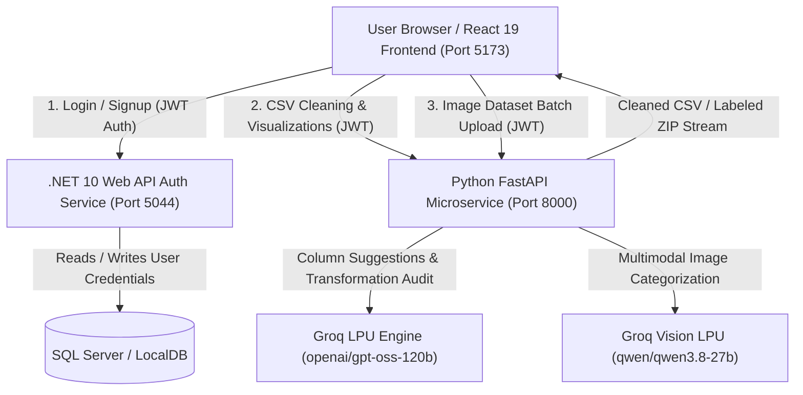

# DataPilot 🚀 — AI Dataset Cleaner & Multimodal Vision Labeling Studio

<p align="center">
  
  
  
  
  
  
  
  
</p>

<p align="center">
  <strong>An enterprise-grade, microservice-powered platform for tabular dataset cleaning, comparative before/after data visualization, automated LLM transformation audits, and ultra-fast computer vision dataset auto-labeling via Groq LPUs.</strong>
</p>

---

## 🏷️ GitHub Topics & Tags
`data-cleaning` • `dataset-visualization` • `groq-api` • `multimodal-ai` • `image-labeling` • `computer-vision` • `react19` • `dotnet10` • `fastapi` • `pandas` • `data-science` • `machine-learning` • `llm-audit`

---

## 📑 Table of Contents
1. [Overview & Key Features](#-overview--key-features)
2. [System Architecture](#-system-architecture)
3. [Visual Tour & Screenshots](#-visual-tour--screenshots)
   - [User Authentication](#1-secure-user-authentication)
   - [Workspace & Dataset Upload](#2-workspace-folders--csv-upload)
   - [Dataset Profiling & Global Controls](#3-dataset-profiling--cleaning-controls)
   - [Interactive Imputation Strategies](#4-interactive-imputation-engine)
   - [AI Recommendations & Interactive Chat](#5-groq-ai-insights--conversational-assistant)
   - [Feature 1: Before vs. After Visualizations & Groq Audit](#6-feature-1-before-vs-after-visualizations--ai-audit)
   - [Feature 2: AI Image Dataset Auto-Labeling Studio](#7-feature-2-ai-image-dataset-auto-labeling-studio)
4. [Technology Stack](#-technology-stack)
5. [Getting Started & Installation](#-getting-started--installation)
   - [Prerequisites](#prerequisites)
   - [1. ASP.NET Core Web API](#1-aspnet-core-web-api-datapilot)
   - [2. Python FastAPI AI Microservice](#2-python-fastapi-ai-microservice-ai-service)
   - [3. React Frontend](#3-react-frontend-frontend)
6. [API Reference](#-api-reference)
7. [Contributing & License](#-license)

---

## 🌟 Overview & Key Features

**DataPilot** bridges the gap between raw, messy datasets and production-ready machine learning pipelines. Built on a resilient three-tier microservice architecture, it supports both structured tabular data and computer vision image datasets:

### 📊 Tabular Data Engine
- **Real-Time Dataset Profiling**: Instant parsing of CSV files calculating null percentages, row/column counts, memory cardinality, and data types.
- **Interactive Cleaning Pipeline**: Column pruning, automated duplicate row elimination, text whitespace trimming, and title casing normalization.
- **Configurable Imputation**: Impute missing values with column mean, median, mode (most frequent), placeholder `"Unknown"`, or row dropping.
- **Groq AI Recommendations**: Automated column-drop and imputation recommendations powered by Groq's high-speed inference engine (`openai/gpt-oss-120b`).
- **Interactive AI Assistant**: Real-time side-drawer chat for conversational guidance on schema hygiene and modeling readiness.

### 📈 Feature 1: Before vs. After Visualizations & Groq AI Audit
- **Comparative Side-by-Side Bar Charts**: Visual inspection comparing missing value percentages for every column before and after cleaning.
- **Completeness & Health Gauges**: Visual metrics calculating total dataset matrix completeness gain (e.g. `90.56% ➔ 92.83%`) and retention ratios.
- **Groq AI Transformation Audit**: Automatically generates a natural-language report summarizing what changed, why rows were purged, and readiness for ML training.
- **Column Transformation Ledger**: Filterable audit trail displaying every column's initial and final state.

### 🖼️ Feature 2: AI Image Dataset Auto-Labeling Studio
- **Multimodal Vision Engine**: Powered by Groq's LPU-accelerated **`qwen/qwen3.8-27b`** vision model (~300–500 ms per image).
- **Flexible Ingestion**: Upload individual image files (`.png`, `.jpg`, `.jpeg`, `.webp`, `.bmp`) or an entire `.zip` archive.
- **Dual Labeling Modes**:
  - *Candidate Classes*: Classify each image into custom user-defined categories (e.g. `Defect, Normal, Scratch, Misaligned`).
  - *Open Auto-Detect*: Let Groq infer subjects, visual tags, and short descriptions automatically.
- **Interactive Review Gallery**: Real-time thumbnail grid with confidence scores, hashtag tags, and instant inline label editing.
- **1-Click Dataset Export**:
  - **Foldered ZIP**: Images sorted into category subfolders (`/labeled_dataset/Defect/img1.jpg`, `/labeled_dataset/Normal/img2.jpg`) + `annotations.csv` and `annotations.json`.
  - **Annotations CSV & JSON**: Direct tabular or structured metadata export.

---

## 🏗️ System Architecture



---

## 📸 Visual Tour & Screenshots

### 1. Secure User Authentication
Modern glassmorphism authentication powered by ASP.NET Core with BCrypt hashing and standardized JWT bearer authorization.

| Sign In Screen | Account Registration |
| :---: | :---: |
| .png) | .png) |

---

### 2. Workspace Folders & CSV Upload
Organize datasets by project folders with intuitive drag-and-drop CSV upload and real-time validation.

.png)

---

### 3. Dataset Profiling & Cleaning Controls
Instant statistical profiling showing total rows, columns, duplicate records, global text cleaners, and column health metrics.

.png)

---

### 4. Interactive Imputation Engine
Select column-specific strategies including Mean, Median, Mode (Most Frequent), Unknown, or Row Drops directly from dropdowns.

.png)

---

### 5. Groq AI Insights & Conversational Assistant
Right-hand AI drawer with 1-click action buttons to apply AI suggestions, plus an integrated interactive chat for dataset advice.

| AI Recommendation Engine | Interactive AI Assistant Chat |
| :---: | :---: |
| .png) | .png) |

---

### 6. Feature 1: Before vs. After Visualizations & AI Audit
Comprehensive audit card generated by Groq AI, 5 metric delta KPI cards, side-by-side missing rate comparison bars, and matrix completeness gauges.

#### Groq AI Audit Report & KPI Metric Deltas
.png)

#### Side-by-Side Column Missing Rate Bar Charts
.png)

#### Matrix Completeness Gain & Deduplication Gauges
.png)

---

### 7. Feature 2: AI Image Dataset Auto-Labeling Studio
Multimodal dataset labeling studio powered by Groq LPUs (`qwen/qwen3.8-27b`). Upload batches or ZIP archives, apply candidate classes, and export foldered datasets.

.png)

---

## 💻 Technology Stack

| Layer | Technologies |
| :--- | :--- |
| **Frontend** | React 19, Vite 8, React Router 7, Context API, Vanilla CSS Design System, Responsive Glassmorphic Theme |
| **Auth Microservice** | ASP.NET Core 10 Web API, Entity Framework Core, BCrypt.Net-Next, JWT Bearer Authentication, Swagger/OpenAPI |
| **AI Microservice** | Python 3.11+, FastAPI, Pandas, NumPy, Pillow, PyJWT, Python-Multipart, Uvicorn |
| **AI Acceleration** | Groq API (`openai/gpt-oss-120b`, `qwen/qwen3.8-27b` Multimodal Vision, heuristic fallback engine) |
| **Storage** | Microsoft SQL Server (LocalDB / Azure SQL), Disk Cache & In-Memory Streaming |

---

## 🚀 Getting Started & Installation

### Prerequisites
- [.NET 10 SDK](https://dotnet.microsoft.com/download)
- [Node.js (v18+) & npm](https://nodejs.org/)
- [Python 3.10+](https://www.python.org/)
- [Groq API Key](https://console.groq.com)

---

### 1. ASP.NET Core Web API (`DataPilot`)

```bash
cd DataPilot

# Restore dependencies
dotnet restore

# Run the API server (database will auto-migrate on start)
dotnet run
```
- **Service URL**: `http://localhost:5044`
- **Swagger Documentation**: `http://localhost:5044/swagger`

*Configuration (`DataPilot/appsettings.json`):*
```json
{
  "ConnectionStrings": {
    "DefaultConnection": "Server=localhost;Database=DataCleanerDb;Trusted_Connection=True;TrustServerCertificate=True;"
  },
  "Jwt": {
    "Key": "this-is-a-super-secret-key-change-me-later-min-32-chars",
    "Issuer": "DataCleanerApi",
    "Audience": "DataCleanerApiUsers",
    "ExpiryMinutes": "60"
  }
}
```

---

### 2. Python FastAPI AI Microservice (`ai-service`)

```bash
cd ai-service

# Create and activate virtual environment
python -m venv venv

# Windows:
venv\Scripts\activate
# macOS/Linux:
source venv/bin/activate

# Install dependencies
pip install -r requirements.txt

# Start FastAPI server
uvicorn main:app --reload --port 8000
```
- **Service URL**: `http://localhost:8000`
- **Swagger Documentation**: `http://localhost:8000/docs`

*Environment Configuration (`ai-service/.env`):*
```env
JWT_KEY=this-is-a-super-secret-key-change-me-later-min-32-chars
JWT_ISSUER=DataCleanerApi
JWT_AUDIENCE=DataCleanerApiUsers
GROQ_API_KEY=your_groq_api_key_here
```

---

### 3. React Frontend (`frontend`)

```bash
cd frontend

# Install packages
npm install

# Start Vite development server
npm run dev
```
- **Application URL**: `http://localhost:5173`

---

## 📡 API Reference

### 🔐 Auth Service (`http://localhost:5044/api`)
| Method | Endpoint | Description |
| :--- | :--- | :--- |
| `POST` | `/api/auth/register` | Register a new user profile |
| `POST` | `/api/auth/login` | Authenticate user and issue JWT bearer token |
| `GET` | `/api/user/profile` | Retrieve profile information for authenticated user |

### 📊 Tabular CSV & AI Service (`http://localhost:8000/csv`)
| Method | Endpoint | Auth | Description |
| :--- | :--- | :--- | :--- |
| `POST` | `/csv/upload` | `Bearer <token>` | Upload CSV and compute initial profile statistics |
| `GET` | `/csv/stats/{file_id}` | `Bearer <token>` | Retrieve column statistics for a dataset |
| `POST` | `/csv/ai-suggest` | `Bearer <token>` | Get Groq LLM drop and imputation recommendations |
| `POST` | `/csv/chat` | `Bearer <token>` | Conversational dataset advice via Groq AI |
| `POST` | `/csv/clean` | `Bearer <token>` | Execute cleaning pipeline, compute before/after diffs, and generate AI audit report |
| `GET` | `/csv/comparison/{file_1}/{file_2}` | `Bearer <token>` | Compute comparative before/after metrics on demand |
| `GET` | `/csv/download/{file_id}` | `Bearer <token>` | Stream cleaned CSV file with UTF-8 BOM encoding |

### 🖼️ Computer Vision Labeling Service (`http://localhost:8000/image`)
| Method | Endpoint | Auth | Description |
| :--- | :--- | :--- | :--- |
| `POST` | `/image/label-batch` | `Bearer <token>` | Batch auto-label images or `.zip` archives via Groq Vision (`qwen/qwen3.8-27b`) |
| `POST` | `/image/export-dataset` | `Bearer <token>` | Export labeled dataset as a foldered ZIP, annotations CSV, or JSON |

---

## 🧪 Testing & Verification

Execute all verification checks across frontend and backend services:

```bash
# 1. Frontend production build validation
cd frontend
npm run build

# 2. .NET compilation check
cd ../DataPilot
dotnet build

# 3. Python syntax & test execution
cd ../ai-service
python -m py_compile main.py routers/csv_router.py routers/image_router.py services/image_labeler.py services/csv_cleaner.py services/ai_client.py
```

---

## 📄 License
This project is licensed under the [MIT License](LICENSE).

<p align="center">
  Made with ❤️ using <strong>.NET 10</strong>, <strong>React 19</strong>, <strong>FastAPI</strong>, and <strong>Groq LPUs</strong>.
</p>
